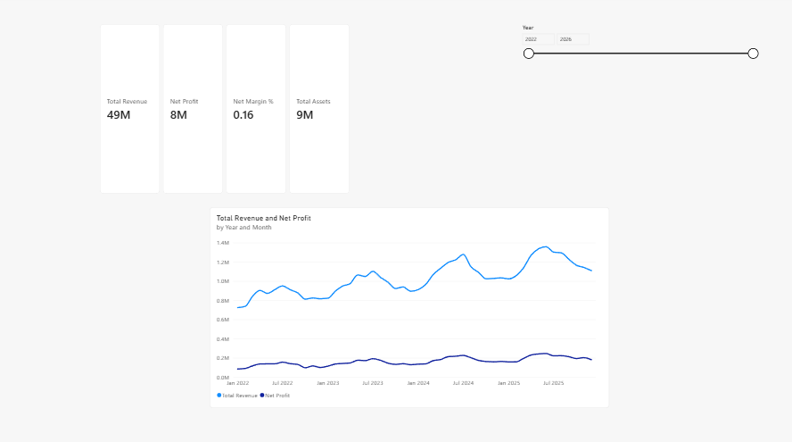
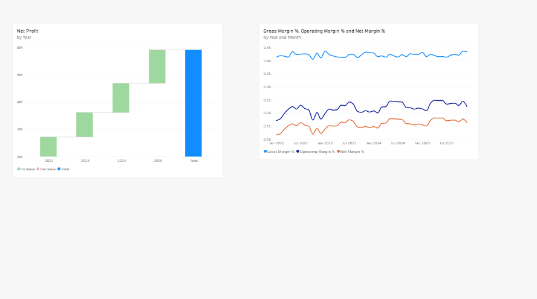
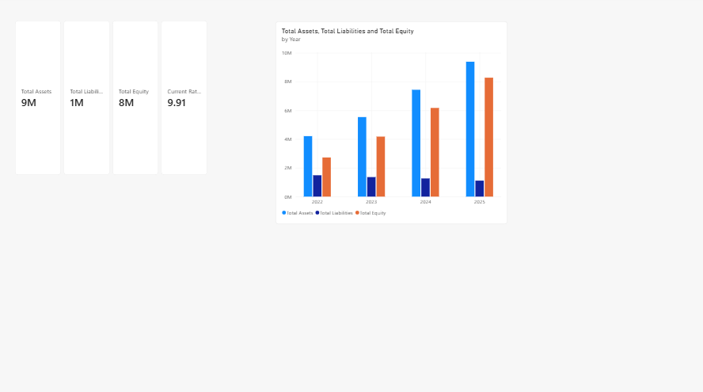
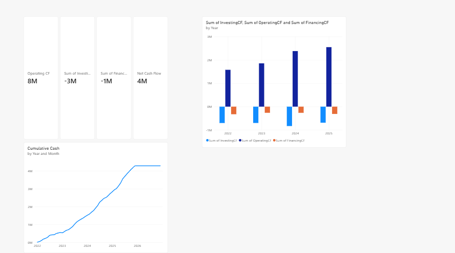
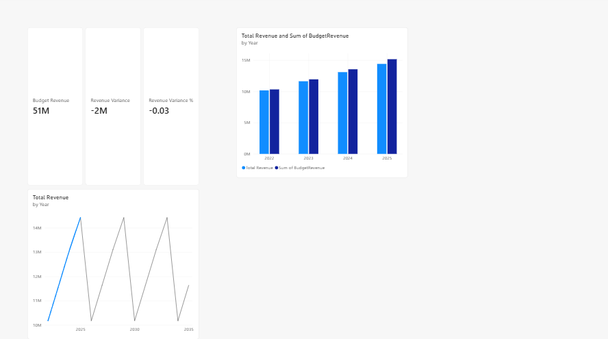

# CodeAlpha Task 1: Financial Health Dashboard

Power BI dashboard analysing the financial health of a small business (SME) using monthly data from Jan 2022 to Dec 2025.

## Objective
Visualize income statement, balance sheet and cash flow, analyse profitability trends over time, and support budgeting with budget vs actual analysis.

## Tools
- Power BI Desktop (Power Query, DAX, data modelling)
- Excel (source data)

## Files
| File | Description |
|---|---|
| CodeAlpha_FinancialHealthDashboard.pbix | Power BI report |
| Financials.xlsx | Source data (IncomeStatement, BalanceSheet, CashFlow, Budget sheets) |
| DAX_Measures.md | Calendar table and all DAX measures |
| 1_overview.png to 5_forecast_budget.png | Report page screenshots |

## Data model
A Calendar date table (DAX) is related one-to-many to the Date column of all 4 tables.

## Report pages
1. **Overview**: Total Revenue, Net Profit, Net Margin %, Total Assets, revenue vs net profit trend, year slicer
2. **Income Statement**: net profit waterfall by year, gross / operating / net margin trends
3. **Balance Sheet**: Total Assets, Liabilities, Equity, Current Ratio, yearly comparison
4. **Cash Flow**: Operating, Investing, Financing and Net Cash Flow, cumulative cash
5. **Forecast & Budget**: Budget vs Actual revenue and variance

## Key measures
Gross Profit, EBIT, Net Profit, Gross / Operating / Net Margin %, Current Ratio, Quick Ratio, Debt to Equity, ROE %, ROA %, Net Cash Flow, Cumulative Cash, Revenue YoY %, Net Profit YTD, Revenue Variance and Variance %.

## How to open
1. Download the repository
2. Open the .pbix file in Power BI Desktop
3. If the data source path breaks: Home > Transform data > Data source settings > Change source, and point to Financials.xlsx

## Screenshots

Submitted as part of the CodeAlpha Power BI internship.
